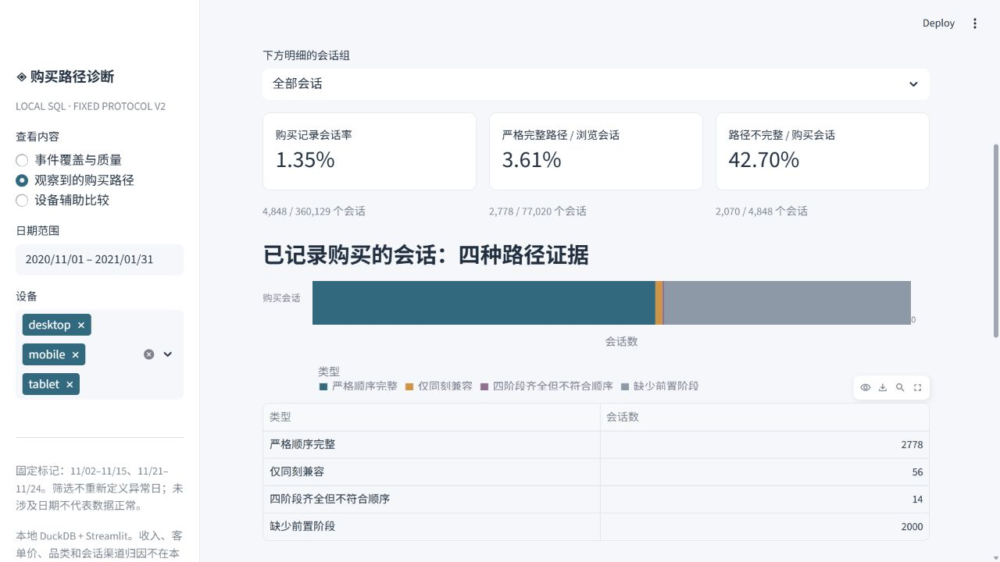

# GA4 Event Quality & Observed Purchase Paths

**A local SQL analytics project investigating what an ecommerce funnel can tell us when event coverage and timestamp ordering are incomplete.**

DuckDB · SQL · Parquet · Python · Streamlit

[中文说明](README.zh-CN.md) · [SQL walkthrough](docs/SQL_WALKTHROUGH.md) · [Metric contracts](docs/METRICS.md) · [Results & history](reports/README.md)

> Published project: [yingluokongcheng/ga4-event-quality-sql](https://github.com/yingluokongcheng/ga4-event-quality-sql). All 92 dates, the fixed 18 flagged dates, timestamp ties and unfavorable findings are retained.

## Research question

**How do event coverage gaps and ambiguous event order affect the purchase paths we can observe?**

A missing step in a funnel is not automatically a lost customer. This project separates stage presence, strict event sequences and timestamp-compatible sequences before interpreting funnel differences. Device comparisons are supplementary.

The analysis uses a pinned **third-party flattened GA4-derived extract**, not an export independently verified against Google's original tables. It covers **4,295,584 event rows, 360,129 identifiable sessions and 92 dates** from November 1, 2020 to January 31, 2021.

## Main findings

| Session cohort | Sessions | Sessions with purchase records | Strict complete paths | Incomplete strict paths / purchase sessions |
|---|---:|---:|---:|---:|
| All | 360,129 | 4,848 | 2,778 | 42.70% |
| Touches fixed flagged dates | 61,771 | 815 | 0 | 100.00% |
| Does not touch flagged dates | 298,358 | 4,033 | 2,778 | 31.12% |

A session touches the flagged period if **any of its events** falls on November 2–15 or November 21–24, 2020. Flags were frozen after the audit and before follow-up comparisons. They are not recalculated after filtering. The unflagged cohort is not assumed to be normal or complete.

- **Incomplete paths are not failed purchases.** The flagged cohort contains 815 sessions with purchase records, yet none has the full view → cart → checkout → purchase path.
- **The 18 dates do not explain every incomplete path.** Outside that cohort, 1,255 of 4,033 purchase sessions still lack a complete strict path.
- **Timestamp ambiguity explains only a small part of the observed gap.** Allowing equal timestamps raises possible complete paths from 2,778 to 2,834. The additional 56 paths do not establish actual event order.
- **Device differences remain descriptive.** Recorded purchase-session rates are 1.39% for mobile and 1.32% for desktop. No causal UX or commercial improvement is established.

All 4,848 purchase sessions partition into **2,778 strict complete**, **56 only tie-compatible**, **14 all stages present but not ordered even allowing ties**, and **2,000 missing prerequisites**. These classify observed records, not customer intent.

[Comparison CSV](reports/analysis/session_comparisons.csv) · [Machine-readable results](reports/analysis/analysis_results.json)

## SQL skills demonstrated

| Capability | Implementation and review entry point |
|---|---|
| Define event/session grain | Preserve source rows; validate identifiers; aggregate using the composite `(user_pseudo_id, ga_session_id)` key without splitting at midnight. [01_stage.sql](sql/01_stage.sql) |
| Find an ordered subsequence | Chained CTEs and inequality joins select each earliest eligible next stage, allowing repeated stages instead of comparing only each stage's first timestamp. [02_paths.sql](sql/02_paths.sql) |
| Diagnose sequence uncertainty | Separate `>` and `>=` matching; conditional aggregation of tied stages; correlated `EXISTS` checks for purchase prerequisites and 24-hour follow-up. [02_paths.sql](sql/02_paths.sql) |
| Build analytical marts | Complete-history flags, `BOOL_OR`, explicit path classes and joins create reusable session and daily tables. [04_reporting.sql](sql/marts/04_reporting.sql) |
| Keep denominators explicit | Fixed cohort/device expansion, `FILTER` counts, `NULLIF` denominators and a calendar spine distinguish missing records from zero events. [summary.sql](sql/marts/summary.sql), [data.py](dashboard/data.py) |
| Validate business semantics | Partition reconciliation and tests of repeated events, ties, cross-date sessions, missing stages, empty filters and censoring. [tests/](tests/) |

SQL performs aggregation, path construction and metric calculations. Python orchestrates ingestion, validation, reporting and the dashboard. Some parameterized reporting SQL lives in `dashboard/data.py`; audit export queries live in `scripts/audit.py`.

This is a DuckDB implementation. It does not claim BigQuery, dbt, Spark, production ETL, window-function usage or measured query-performance improvements.

## Analysis flow

```text
Pinned Parquet files + hash manifest
    → source-preserving events and composite-key sessions
    → strict paths / tie-compatible paths / quality audit
    → fixed session and daily reporting marts
    → parameterized SQL → CSV/JSON + local Streamlit dashboard
```

1. **Audit first:** inspect coverage, identity, session boundaries, repeated keys, transaction fields and timestamp ties.
2. **Freeze scope:** retain all dates, flag the 18 zero-cart dates and suspend unsupported revenue/attribution questions.
3. **Build full-history paths before filtering:** session-date filters cannot truncate an event sequence.
4. **Compare records:** show all three cohorts and the four purchase-path classes together.
5. **Validate and preserve:** retain audit and follow-up results, including limitations.

[Fixed protocol](docs/PROTOCOL.md) · [SQL decisions and examples](docs/SQL_WALKTHROUGH.md)

## Local dashboard

Three Chinese-language pages cover event quality, observed purchase paths and descriptive device comparisons. Filters and CSV exports share reporting queries. Event charts use event dates; session panels use first-observed session dates; user-level follow-up uses checkout anchor dates.



This screenshot is from the local application, not a hosted live service.

## Run locally

**Tested environment:** Windows, Python 3.12, DuckDB 1.4.3 and Streamlit 1.50.0. Other operating systems have documented commands but were not validated in this run.

Download/extract the repository and open a terminal in its root. Run:

```powershell
python scripts/setup_local.py
.venv/Scripts/python -m streamlit run app.py
```

On Windows, you can instead double-click **Setup.cmd**, then **Start_dashboard.cmd**. Setup creates `.venv`, installs pinned dependencies, downloads 114 files at a fixed commit, verifies hashes and builds the local database/results. The setup script accepts Python 3.10+, but Python 3.12 is the tested version.

Open **http://127.0.0.1:8501** and keep the process running; Ctrl+C stops it. If this dashboard is already running there, open the address without starting a second instance. On macOS/Linux, use `.venv/bin/python`.

Initial installation/download requires ordinary internet access and about 274 MB of source data, plus space for dependencies and the database (allow roughly 2 GB or more). **No Google Cloud project, billing or credentials are required.** After setup, analysis uses local data. The service binds to loopback only and Streamlit usage collection is disabled. If another application occupies the port, add `--server.port=8502`.

Raw data, databases and virtual environments are excluded. The downloader depends on upstream files remaining available.

## Rebuild and validate

Stop the dashboard before rebuilding the database.

```powershell
.venv/Scripts/python scripts/download.py --verify-only
.venv/Scripts/python scripts/audit.py
.venv/Scripts/python scripts/build_analysis.py
.venv/Scripts/python scripts/report_analysis.py
.venv/Scripts/python -m unittest discover -s tests -v
```

The original audit HTML is a retained historical report; these commands rebuild audit CSV/JSON and the current analysis HTML. Full tests require setup/data. To run only the six synthetic path-semantic tests after installing dependencies:

```powershell
.venv/Scripts/python -m unittest discover -s tests -p test_semantics.py -v
```

The implementation milestone passed **14 tests**. A fresh database rebuild from cached inputs reproduced **36 result files byte for byte** with Python socket connection/DNS methods blocked; this was not an operating-system firewall test. The original audit's 47 files remained unchanged. These checks validate local reproducibility and implemented semantics, not original-data completeness.

[Historical verification](reports/verification.json) · [Packaging review](docs/RELEASE_REVIEW.md)

## Limitations

- **Source lineage:** the upstream extraction notebook and stored schema do not fully agree. Hash verification fixes the input version; it does not verify completeness against Google.
- **Behavior:** missing purchase records cannot distinguish nonpurchase from tracking gaps, export transformations, obfuscation, identity changes or observation boundaries. No true churn estimate is made.
- **Units:** pseudo-users are not necessarily people; events are not verified orders; a session path need not be a same-item or same-cart journey.
- **Order:** tie-compatible counts are possible observed-sequence counts, not confidence intervals or bounds on true behavior. Step ratios use different denominators and are not interval bounds.
- **Unsupported outcomes:** missing item/currency/revenue fields and transaction inconsistencies prevent defensible revenue, AOV and category analysis. First acquisition is not current-session attribution.
- **Inference:** no hypothesis test, causal device comparison, production deployment or business uplift is claimed. The flagged dates describe an observed anomaly; they do not identify its cause.

## Repository guide

```text
README.md / README.zh-CN.md    English homepage and Chinese explanation
sql/                          event/session contracts, paths, audit and marts
dashboard/data.py             shared read-only parameterized SQL
app.py                        local Streamlit interface
scripts/                      pinned download, build, report and setup
tests/                        semantic, reporting and UI checks
docs/                         protocol, metrics, SQL walkthrough and review notes
reports/audit_v1/              original audit CSV/JSON/Chinese HTML and checks
reports/analysis/              fixed follow-up CSV/JSON/Chinese HTML
reports/screenshots/           dashboard evidence
provenance/                   pinned hashes, source notes and upstream notices
requirements*.txt              dependency pins
Setup.cmd / Start_dashboard.cmd
```

[Detailed structure](docs/STRUCTURE.md) · [Results archive](reports/README.md)

## Data attribution

Inputs come from [DavidKingGH/dbt_portfolio_project_1 at commit 41c4ee8](https://github.com/DavidKingGH/dbt_portfolio_project_1/tree/41c4ee829b7c18cdb52810686768edfa035a42e0/ga4_data/fct/fact_events). This project's SQL analysis and dashboard are separate from that repository's models and reported findings.

[Source limitations](provenance/SOURCE_NOTES.md) · [File manifest](provenance/source_manifest.json) · [Third-party notices](NOTICE.md)

Upstream code licensing does not establish redistribution rights to Google's underlying data. Raw data is not bundled. Historical evidence is retained without upgrading it into a claim of source completeness.
